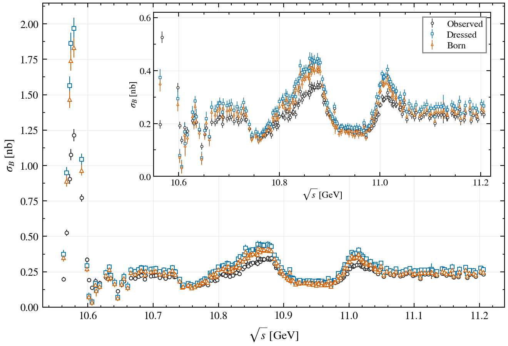
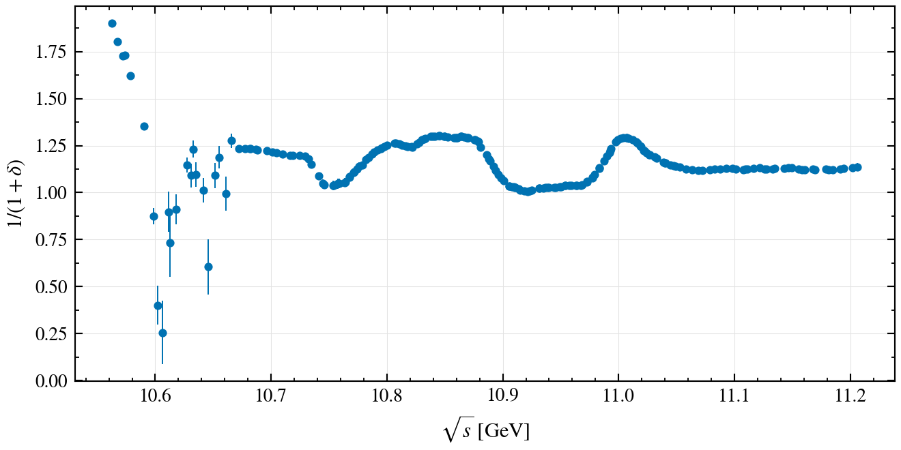
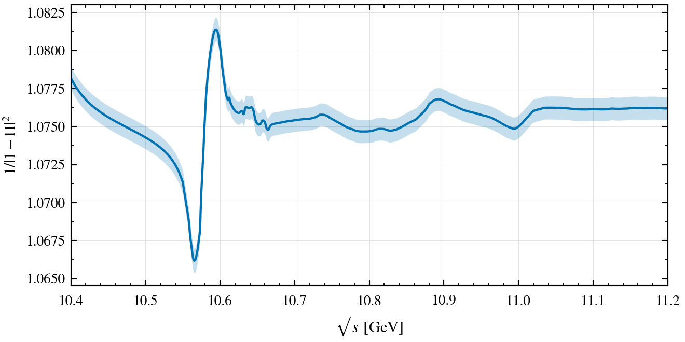

# ISR and VP factors in the bottomonium region

Corrected calculation accompanying the erratum to [X.-K. Dong et al., Chinese Physics C **44**, 083001 (2020)](https://doi.org/10.1088/1674-1137/44/8/083001). The current results use published BES inclusive R measurements and the corrected numerical methods described below.

[Erratum PDF](docs/erratum_besii/main.pdf) · [Complete numerical table](results/paper_method_corrected/results.csv) · [Data and uncertainty guide](results/paper_method_corrected/README.md)

## Cross sections



[Cross-section data (CSV)](results/paper_method_corrected/cross_sections.csv) · [Vector figure (PDF)](docs/erratum_besii/figures/cross_sections.pdf)

The 209 observed points are the unsmoothed experimental inputs. Dressed and Born cross sections are calculated from paired experimental samples and correction factors; error bars show total propagated input uncertainties. The inset enlarges 10.55–11.22 GeV.

## ISR correction factors



[ISR data (CSV)](results/paper_method_corrected/isr.csv) · [Vector figure (PDF)](docs/erratum_besii/figures/isr.pdf)

The plotted correction is $1/(1+\delta)$. It converts the observed cross section to the dressed cross section. ISR uses the bottomonium input and does not depend on the BES charm-region data.

## VP factors



[VP at measured energies (CSV)](results/paper_method_corrected/vp.csv) · [Plotted VP curve and band (CSV)](results/paper_method_corrected/vp_dense.csv) · [Vector figure (PDF)](docs/erratum_besii/figures/vp.pdf)

The plotted factor is $F_{\mathrm{VP}}=1/|1-\Pi|^2$; the band represents the total fitted input uncertainty. Born cross sections are obtained by dividing the dressed cross sections by this factor, sample by sample. The displayed curve extends down to 10.4 GeV and uses the calculated refined grid without additional smoothing.

## Corrections and methods

- Replace the unpublished charm-region input by published BES inclusive R measurements: 76 points from 3.70–4.80 GeV from [PRL **88**, 101802 (2002)](https://doi.org/10.1103/PhysRevLett.88.101802), plus the 5.00 GeV point from [PRL **84**, 594 (2000)](https://doi.org/10.1103/PhysRevLett.84.594). Both measurements used the BESII detector. At 4.60 GeV the 2002 measurement is used. See the [input table](data/besii/input.csv) and [archived PDG compilation](data/besii/pdg2020-R.dat).
- Restore the missing $1/\alpha(0)$ in the hadronic VP imaginary part and correct the two-pion conversion constant to $389379000\,\mathrm{nb}\,\mathrm{GeV}^{2}$.
- Improve the principal-value integration and remove the inconsistent second smoothing before the VP calculation. The pQCD grid resumes at 5.05 GeV after the BES input.
- Use robust local-linear LOWESS with span 0.045, starting at 10.6659 GeV, with three bisquare reweighting passes. Both ISR and VP iterations stop when the maximum relative correction-factor change is below $10^{-4}$ (0.01%).
- Use 10,000 Gaussian input samples per ensemble, seed 20261020, and unbinned Gaussian maximum-likelihood estimates for central values and widths. Samples are not clipped. Some ISR distributions depart from Gaussian shape; per-point diagnostics are supplied.

Statistical, systematic and unresolved low-energy background errors are propagated separately. The last component is **not** classified as purely statistical or systematic. Total errors come from simultaneous variation, rather than an imposed quadrature sum of separate ensembles. The [error-component table](results/paper_method_corrected/error_components.csv) and [data guide](results/paper_method_corrected/README.md) describe the adopted correlations and covariance files. These errors do not include additional model or smoothing uncertainties. No resonance fit was repeated.

## Reproduce

The numerical calculation requires only Julia standard libraries (tested with Julia 1.12.6). All required inputs are bundled; MATLAB, the thesis and the external drive are not required.

```sh
julia --project=. test/runtests.jl
julia --project=. scripts/run_paper_method_corrected.jl
julia --project=. scripts/check_paper_resolution.jl
python3 scripts/export_erratum.py
```

The production calculation generates four 10,000-sample ensembles and can take substantial time. To regenerate the three figures, install NumPy, Matplotlib and Pillow, then run:

```sh
python3 docs/erratum_besii/revision/generate_revision.py
cd docs/erratum_besii
pdflatex -interaction=nonstopmode -halt-on-error main.tex
pdflatex -interaction=nonstopmode -halt-on-error main.tex
```

The TeX directory is self-contained. See [production validation](results/paper_method_corrected/validation.toml), [resolution checks](results/paper_method_corrected/resolution.toml), and [independent integration checks](results/besii_corrected/independent_methods.toml). The current run passed 64 Julia tests; ISR required at most 17 iterations and VP 3. `SHA256SUMS` records the distributed files; rerunning numerical calculations may change their hashes.

## Repository layout and historical results

| Location | Purpose |
| --- | --- |
| `src/`, `scripts/`, `test/` | Julia implementation, runners, exports and tests |
| `data/` | Bundled experimental and historical inputs |
| `results/paper_method_corrected/` | **Current erratum results**, uncertainty components and diagnostics |
| `docs/erratum_besii/` | Current manuscript, self-contained figure sources and PDF |
| `results/besii/` | Historical input-only BES replacement; superseded |
| `results/besii_corrected/` | Intermediate numerical checks before the final robust smoothing and uncertainty treatment |
| Other result directories and older audit documents | Historical reproduction and provenance; not the current erratum |

The `paper-reproduction` branch preserves the published-result replay; `numerical-updates` preserves the earlier numerical audit. This branch combines the published BES input with the corrected calculation and the final method choices used for the erratum.
