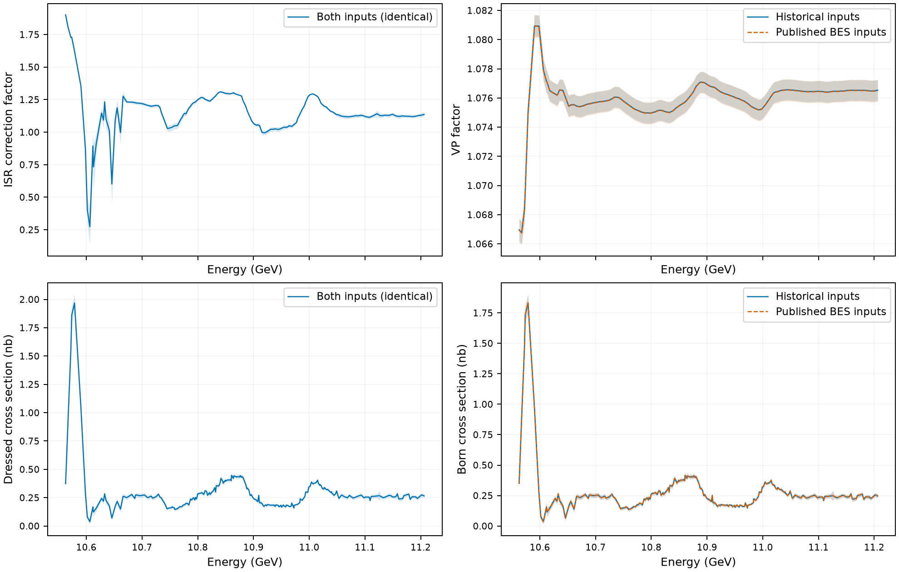

# Bottomonium ISR and VP factors — BES input consistency branch

This branch, `besii-paper-consistency`, replaces the internal charm-region inputs with published **BES inclusive R measurements**, as cited in [our CPC paper](https://arxiv.org/abs/2002.09838). It starts from `paper-reproduction` (`5cabb61`) and keeps the historical numerical algorithm. The separate `numerical-updates` branch remains unchanged.

**This is an input-only revision, not a complete numerical correction or a finalized erratum.** Known historical issues (the hadronic imaginary term, pion unit conversion, finite iteration counts and different smoothing starts) remain deliberately visible; see [scope and assumptions](docs/besii_work_plan.md).

## Results

The current results are in [`results/besii/results.csv`](results/besii/results.csv). They cover all 209 experimental bottomonium energies and include ISR and VP factors, dressed and Born cross sections, and propagated errors. Cross sections are formed from **unsmoothed experimental samples**, with paired ISR and VP factors. Older `results/historical` and `results/vp` files are historical references, not this branch's new results.



[Comparison with the paper-reproduction baseline](results/besii/comparison.csv) · [Input comparison](results/besii/figures/input_comparison.png) · [Validation report](results/besii/validation.toml) · [Interpretation](docs/besii_results.md)

## Input selection

- 76 points from 3.70 to 4.80 GeV: J. Z. Bai et al. (BES), [PRL 88, 101802 (2002)](https://doi.org/10.1103/PhysRevLett.88.101802).
- The 5.00 GeV endpoint: J. Z. Bai et al. (BES), [PRL 84, 594 (2000)](https://doi.org/10.1103/PhysRevLett.84.594).
- At the duplicate 4.60 GeV energy, use the 2002 measurement. No unprescribed average is taken.
- Values and errors come from the archived [PDG table](data/besii/pdg2020-R.dat); the original paper sources and input hashes are bundled in `data/besii/`.
- The measured inclusive R is used directly, without adding a light-quark constant or separate charm channels. The pQCD grid resumes at 5.05 GeV.

Both publications used the BESII detector; their collaboration name is BES. Each charm uncertainty component uses a common Gaussian nuisance across energies, following the historical implementation. Its two random streams are recovered from the old inputs and reused for a paired comparison. This is a reproduction assumption, not the experimental covariance matrix. No internal charm measurements enter the revised production calculation; the old inputs are retained under `reference/legacy_charm/` only for comparison.

## Run

Only Julia standard libraries are required for the calculation. Tested with Julia 1.12.6.

```sh
julia --project=. --threads=4 test/runtests.jl
julia --project=. --threads=4 scripts/reproduce_vp.jl
```

The second command recomputes both 10,000-sample ISR ensembles and the old/new VP ensembles, writes cross sections and covariance matrices, and checks the historical replay and direct-integration reference. It does not need the external drive, desktop archive, thesis, or MATLAB.

To regenerate input arrays from the bundled central values and shared random streams:

```sh
julia --project=. scripts/rebuild_besii_inputs.jl
```

For figures, install NumPy and Matplotlib and run `python3 scripts/plot_besii_results.py`. For the original historical VP replay use `scripts/reproduce_vp_legacy.jl`.

## Output conventions

ISR central values use the statistical ensemble mean and errors use the total ensemble standard deviation, matching the historical convention. VP and cross-section summaries use all 10,000 paired total samples. The first background sample is random and is **not** labeled a nominal prediction. Covariances retain shared backgrounds and the dependence between correction factors and experimental inputs. Reported errors do not include unquantified numerical/model systematics. Correlation assumptions and numerical sensitivity checks are documented separately.
