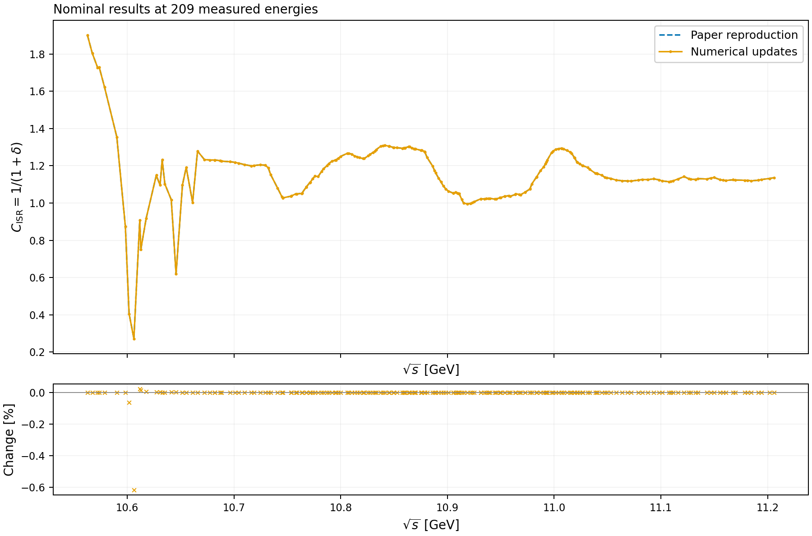
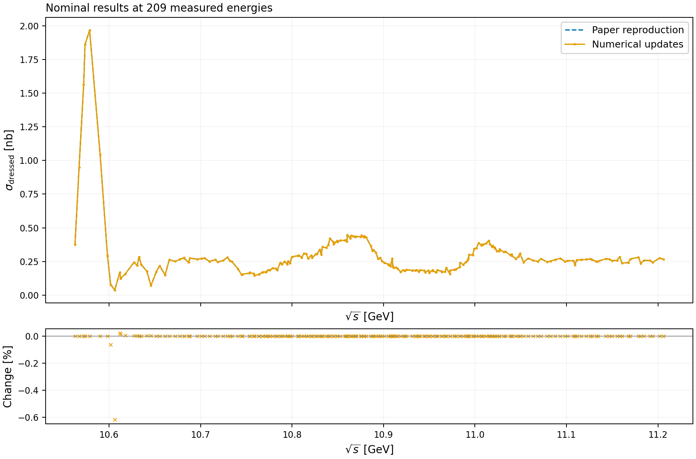
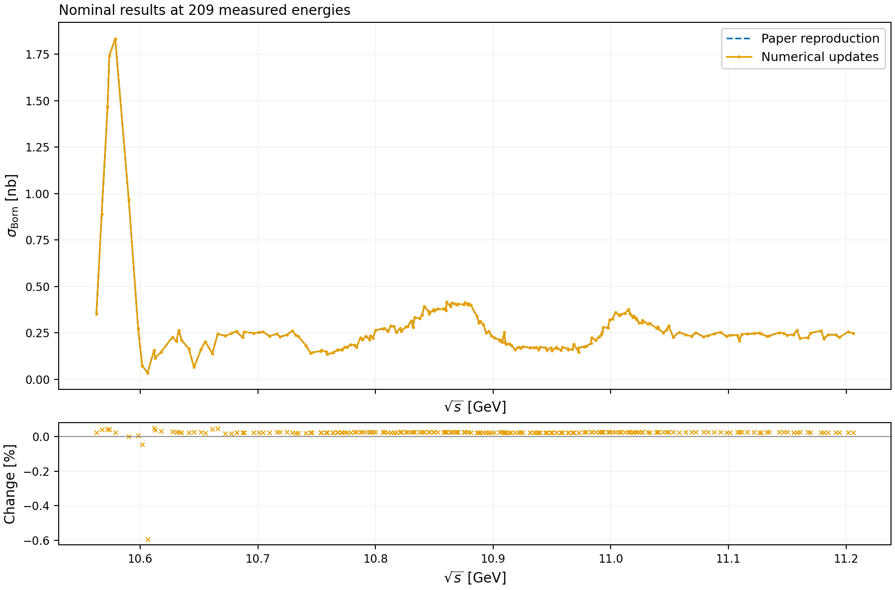
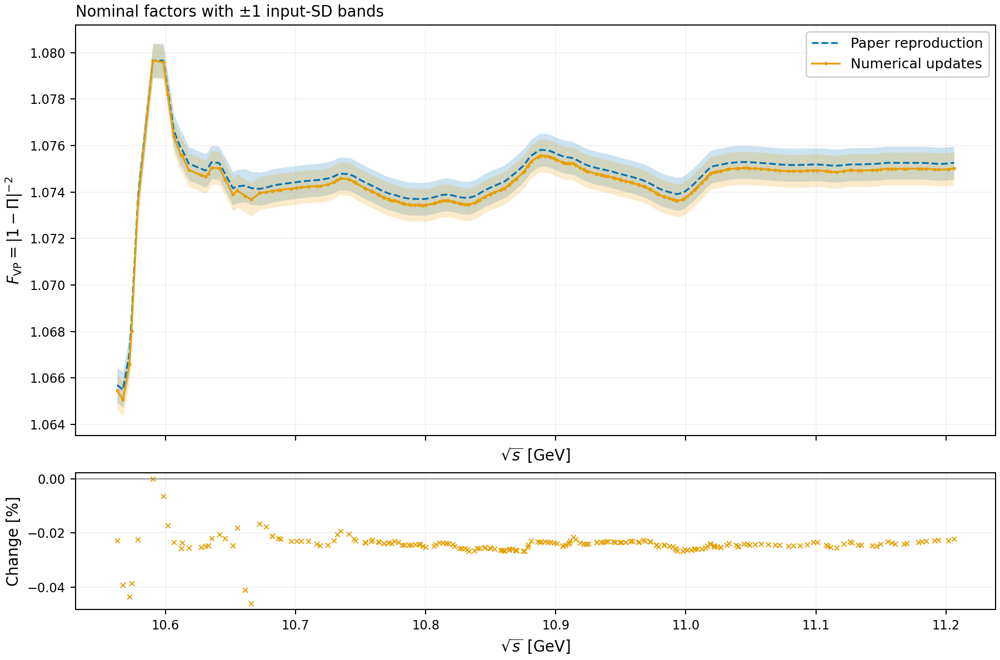

# PaperISR.jl: paper reproduction and numerical updates

A standalone Julia package for reproducing the initial-state radiation (ISR) and vacuum-polarization (VP) correction factors in the appendix of [arXiv:2002.09838](https://arxiv.org/abs/2002.09838), with a separate implementation of numerical corrections and uncertainty propagation.

**Use the results directly:** the [reader results package](reader_results/README.md) contains CSV tables for all 209 measured energies, PNG and vector PDF figures, updated covariance matrices, and reading examples. It can be distributed independently. Reading the tables or regenerating the figures does not require the original repository or an external drive.

## Main results: comparison of the two versions

Blue dashed curves show the paper-reproduction version; orange solid curves show the numerical updates. All four figures compare **results evaluated at nominal inputs**. The lower panels show $100(X_{\rm new}/X_{\rm old}-1)\%$. Lines connect the 209 measured energies to guide the eye; they are not additional fits to a continuous spectrum. The ensemble means used for the published centers are provided separately in the CSV files. See the [detailed change notes](reader_results/CHANGES.md).

### ISR correction factor

The plotted quantity is $C_{\rm ISR}=1/(1+\delta)$. The nominal results largely overlap, with the largest differences at low energies. The maximum relative change is approximately 0.618%.



[Point-by-point data](reader_results/data/comparison_isr.csv) · [Vector PDF](reader_results/figures/github_isr.pdf)

### Dressed cross section

Cross sections are in nb. Both versions multiply the original, unsmoothed experimental cross section by their respective ISR correction factors. Smoothing is used to determine the correction factors; it does not replace the experimental data in the reported cross sections.



[Point-by-point data](reader_results/data/comparison_sigma_dressed_nb.csv) · [Vector PDF](reader_results/figures/github_sigma_dressed.pdf)

### Born cross section

Both versions use $\sigma_{\rm Born}=\sigma_{\rm obs}^{\rm raw}C_{\rm ISR}/F_{\rm VP}$, in nb. Ensemble means and uncertainties are calculated from paired sample ratios, preserving correlations between the experimental input, ISR and VP. The historical Born table is derived from the validated historical samples; it has not been independently matched to a published Born table.



[Point-by-point data](reader_results/data/comparison_sigma_born_nb.csv) · [Vector PDF](reader_results/figures/github_sigma_born.pdf)

### VP factor with uncertainty bands

Each shaded band spans one **propagated input standard deviation** above and below its nominal central value. Historical standard deviations use 10,000 entries, including the nominal input. Updated standard deviations exclude that entry and use 9,999 random samples. These bands do not include additional smoothing or perturbative-QCD model uncertainties, and are not Monte Carlo standard errors of the mean. The two versions share correlated inputs, so band overlap is not a significance test for independent measurements.



[Point-by-point data](reader_results/data/comparison_vp.csv) · [Vector PDF](reader_results/figures/github_vp.pdf)

## Branches and updated calculations

- `paper-reproduction`: preserves the historical calculation matching the paper appendix, starting at commit `5cabb61`.
- `numerical-updates`: provides corrected formula implementations and unit conversions, direct ISR inversion with residual checks, converged VP iteration, a single configurable smoothing stage, and paired covariance propagation.

The cross-section conversion uses $1\,\mathrm{GeV}^{-2}\simeq389379000\,\mathrm{pb}$ consistently in the updated pion and muon terms; the historical pion value $380379000$ is retained only for reproduction. See the [unit-conversion check](docs/vp_reproduction.md#截面单位换算常数核对).

The updated implementation is in `src/updated.jl`; historical interfaces retain their original behavior. Run the following from the repository root:

```sh
julia --project=. test/runtests.jl
julia --project=. scripts/audit_updates.jl
julia --project=. scripts/check_updated_methods.jl
julia --project=. scripts/validate_updates.jl
julia --project=. scripts/export_observed_cross_sections.jl
```

Numerical audit outputs are in `results/updates/`, with the accepted scope recorded in `acceptance.toml`. Negative unfolded sample estimates are retained rather than clipped. Smoothing and perturbative-QCD model uncertainties are not included in the input covariance. See the [numerical audit report](docs/numerical_updates.md).

The dressed/Born columns in `results/updates/` preserve the earlier audit of the smoothed solver spectrum. **The reported cross sections apply the factors to the original experimental data:** their results and covariance matrices are in `results/observed_cross_sections/`, generated by `scripts/export_observed_cross_sections.jl`. The reader tables and main figures use these reported results.

## Historical reproduction

The historical workflow follows the original MATLAB implementation and reproduces the appendix ISR and VP correction factors and their uncertainties.

**Validation:** all 209 appendix points pass the historical ISR and VP comparisons. The historical test suite passed 25 tests; the expanded updated suite passed 45 tests. The full ISR → dressed $R_b$ → VP chain has been replayed. Reported dressed/Born cross sections and paired uncertainties are also available. Resonance fitting has not undergone end-to-end validation.

## Repository layout

- `src/`: integration kernels, ordinary LOWESS smoothing, historical iterations, updated solvers and sampling utilities.
- `scripts/reproduce.jl`: historical ISR replay and fresh-seed sampling.
- `scripts/reproduce_vp.jl`: full ISR-to-VP replay, or replay from saved VP inputs.
- `scripts/vp_convention_check.jl`: comparison of the historical hadronic imaginary-part implementation with the paper convention.
- `scripts/export_observed_cross_sections.jl`: reported cross sections from original experimental inputs and paired correction factors.
- `scripts/export_legacy.py`: one-time extraction of inputs from the original MATLAB files.
- `data/`: cross sections, uncertainties, historical samples and provenance.
- `reference/`: appendix values and historical outputs used for validation.
- `reader_results/`: ready-to-use data tables, figures, covariance matrices and a standalone Python plotting script.
- `test/`: numerical-kernel and regression tests.
- `docs/`: methods, inputs and limitations.
- `results/`: computed outputs and validation reports.

## Running the historical calculation

The Julia calculation uses only standard libraries and was developed and tested with Julia 1.12.6. From the repository root:

```sh
julia --project=. test/runtests.jl
julia --project=. --threads=4 scripts/reproduce.jl historical
julia --project=. --threads=4 scripts/reproduce.jl fresh 10000 2020
julia --project=. --threads=4 scripts/reproduce_vp.jl
julia --project=. scripts/reproduce_vp.jl saved
```

Inputs are bundled with the repository. Running the Julia calculation requires neither MATLAB nor Python, an external drive, or the original project. Historical mode repeats smoothing and unfolding from the saved input samples; saved ISR factors are used only for validation. Fresh-seed mode generates new samples and is not expected to reproduce finite historical ensemble means bit for bit.

ISR outputs are written to `results/historical/` and `results/fresh/`. VP outputs are written to `results/vp/` or `results/vp_saved/`. Each workflow writes a `validation.toml` report; failed checks do not produce a new successful validation report.

## Historical conventions

The historical energy grid starts at the threshold $10.55852\,\mathrm{GeV}$, with the cross-section conversion $\sigma=86.85R/s$ in nb. Ordinary LOWESS smoothing starts at point 23, corresponding to $10.6659\,\mathrm{GeV}$, with span fraction 0.045 and no robust reweighting. ISR smoothing is applied at initialization. The historical ISR calculation interpolates in $s=E^2$, integrates segments analytically, and solves sequentially in energy using 30 stored states, or 29 updates. The historical VP stage retains its separate smoothing convention.

For ISR, appendix centers are the ISR-correction-factor means from statistical-input samples, while uncertainties are sample standard deviations from total-input-error samples. VP centers and uncertainties use the historical total-input ensemble. Nominal-input results and ensemble means are distinct. The audit compares different ISR iteration counts rather than assuming that the historical choice is converged.

## One-time input extraction and provenance

Maintainers with access to the original `VP_B` archive can run `python scripts/export_legacy.py` using NumPy and SciPy. This optional import step reads the original MATLAB files, exports the calculation inputs, and records SHA-256 hashes. Distribute the exported `data/` directory with the package; ordinary users do not need to repeat this step.

Binary samples use little-endian Float64, with all energy points for each sample stored consecutively. Array shapes are recorded in the provenance files. Julia loads them as energy-by-sample matrices. The bottom-region sample arrays are approximately 16.8 MB each; background arrays have different sizes.

For the historical ISR replay, the maximum absolute appendix differences are $8.39\times10^{-12}$ for central values and $2.57\times10^{-13}$ for uncertainties. Historical replay and fresh-seed ISR runs each used 10,000 entries. For the full historical VP chain, the maximum absolute differences are $7.33\times10^{-15}$ for central values and $7.49\times10^{-18}$ for uncertainties. See the [reproduction record](docs/reproduction.md).

The [VP reproduction notes](docs/vp_reproduction.md) describe the input chain and the differences between the historical implementation and the paper formulas. Historical mode deliberately preserves the original hadronic imaginary-part coefficient; it is not a literal implementation of every formula in the paper.

An open-source license has not yet been selected.
