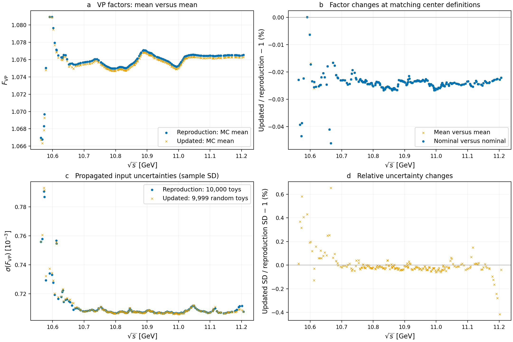

# 两分支 VP 对比

比较 `paper-reproduction`（5cabb61）与 `numerical-updates`（27d9bd1）的已提交结果，逐点对齐全部 209 个测量能点。此次读取并比较已验收结果，未重新运行 Julia 全样本计算。

图 a 比较抽样均值；图 b 分别比较均值与均值、名义值与名义值；图 c 比较传播标准差；图 d 为标准差的相对变化。所有相对变化定义为 $100(X_{\rm new}/X_{\rm old}-1)\%$。名义值来自名义输入；历史名义值采用与历史抽样计算一致的第 3 次 VP 迭代。

| 比较量 | 最大绝对相对变化 | 绝对相对变化中位数 |
|---|---:|---:|
| 抽样均值 | 0.046103% | 0.024103% |
| 名义值 | 0.046090% | 0.024088% |
| 传播标准差 | 0.654381% | 0.026618% |

三项最大变化均位于 $10.6659\,\mathrm{GeV}$。该点抽样均值由 $1.075439575$ 降至 $1.074943770$，标准差由 $0.000709049$ 变为 $0.000713689$。

更新后标准差为 $0.000705962$–$0.000793043$，对应均值的相对误差约 $0.0656\%$–$0.0743\%$。标准差变化范围为 $-0.415626\%$ 至 $+0.654381\%$；这里的百分比以旧标准差为分母。

历史统计包含 10000 项，其中第一项是名义输入；更新统计排除第一项，使用 9999 个随机样本。两者沿用历史输入误差模型，包含共同背景输入，不应当视为独立实验。这里未计入光滑模型、pQCD 模型或新增实验相关性的不确定度。

此前约 0.1646% 的最大差异比较的是“更新名义值与文章抽样均值”，混合了中心值定义。统一定义后，分支间最大差异约为 0.0461%。本对比显示整体更新效果，不将差异单独归因于某一个修正。

复现命令：`python scripts/compare_vp_branches.py`（需要 NumPy、Matplotlib 和本地 figure-hygiene 的几何检查工具）。源文件哈希及绘图来源见 `provenance.json`；逐点数据见 `comparison.csv`。能点一致性、有限正值、源结果验收、数据哈希、图中文字几何检查和 display acceptance 检查均通过，四个面板已逐一目视检查。
